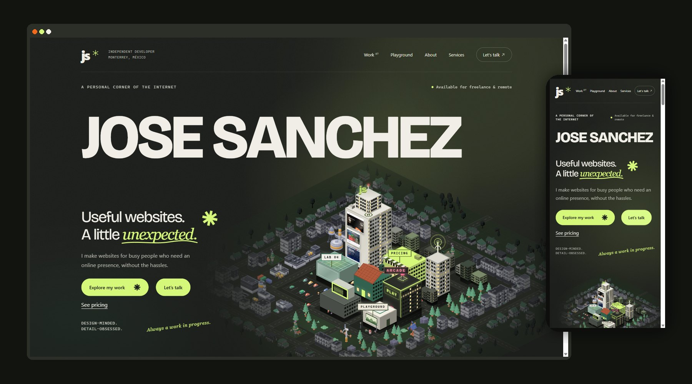

<div align="center">

# Jose Sanchez — Front-End Developer

**Fast, responsive interfaces for real businesses, from first pixel to launch-ready.**<br>
Portfolio covering nutrition, industrial, fitness, food, e-commerce, media, real estate, logistics and travel.

<br>

[](mailto:devilfruitd3v@proton.me)


<br>



</div>

<br>

## Current studio portfolio

[View the live portfolio](https://hechoporjs.com/) · [Open the sandbox section](https://hechoporjs.com/#sandbox)

The default route shows the editorial portfolio, in this order: the hero with an isometric city, selected work (a 3D project carousel), services and pricing, Behind the browser (About, the learning lab, the arcade and the Linux sandbox in one section), the playground, and contact. The hero offers "Explore my work", "Let's talk" and "See pricing". The previous design remains available at `?view=original`.

### Hero: a city made of the site

The hero is a small isometric city, and its eight landmark buildings are the site's navigation. Hover or tab to a building to see its label and a lime ring; click it and the camera flies in, then the page scrolls to that section.

| Building | Opens |
|---|---|
| Work tower (with the lead project screenshots) | `#work` |
| Services shop | `#services` |
| Contact antenna | `#contact` |
| Learning lab | `#learning` |
| About house | `#about` |
| Arcade | `#arcade` |
| Sandbox computer | `#sandbox` |
| Playground gallery | `#playground` |

Around downtown sit an industrial district, a parking lot, a commercial belt with pocket parks, an outer ring road, suburbs and woods that fade into the background, plus a restrained holiday layer (a twinkling town tree, presents, lanterns, snowmen). Cars drive a connected road network in their own lanes, take turns through each junction and keep their distance; residents walk the sidewalks and cross at crosswalks, which closes the junction to cars while they cross. Everything stops for `prefers-reduced-motion`, pauses when the city is off screen, and phones get lighter traffic and fewer outskirts.

The city is CSS 3D, not a game engine. Buildings, trees, cars and people are [Kenney](https://kenney.nl) CC0 3D models, rendered offline into sprites from the city's exact camera angle (people include walk and idle animation frames). The outer rings' dimming is baked into their images rather than applied as CSS filters, which keeps the frame cost down.

- Layout, landmarks and their section targets: `src/data/cityLayout.ts` (one list maps buildings to sections)
- Traffic and pedestrian simulation: `src/components/cityTraffic.ts`
- Rendering: `src/components/IsoCity.tsx`, styles in `src/iso-city.css` and `src/iso-city-world.css`
- Sprites and their sizes: `public/city/`, `src/data/citySprites.ts`; licenses in `public/city/LICENSE.txt`

### Selected work

`#work` is a fanned 3D carousel: the active project faces you with a lime glow, the others recede on both sides. Move with the arrows, the dots, a click on a side card, the arrow keys or a swipe. "Project details" opens the description, tags and, for AFH Logistics, the design notes and wireframe comparison. Each project keeps its own anchor. See [workbench notes](docs/workbench.md).

### Services and pricing

`#services` lists **Launch from $300 USD**, **Business Website from $650 USD** and **Custom Build by quote** on the left. The selected plan opens in a showcase card with what's included, a laptop-and-phone preview of a real client site (Smashouse, AFH Logistics, El Sótano Cómico), the price, a button that opens the contact form with a pre-filled message, and "View example". The orange and blue accents are used only inside that card. Edit prices and deliverables in `src/data/services.ts`. The contact form emails messages through Web3Forms; see `docs/contact-form.md`. See [services notes](docs/services-section.md).

Smashouse's HTTPS address returned a certificate error when last checked, so its preview uses a local screenshot.

### Behind the browser

One section at `#about` holds four parts:

1. **Personal corner:** a Digimon fan companion you can feed, train, rest and pet ([notes](docs/digimon-pet-plan.md)).
2. **Learning lab:** five working labs (JavaScript, React, SQL, Python, AWS) with real code that runs in a sandbox ([notes](docs/learning-lab.md)).
3. **Arcade:** a tiny space game ("Take a little break").
4. **Sandbox:** "Open desktop" boots a little Linux desktop (below).

### Playground: Monterrey, live

The poster at `#playground` is a live portrait of Monterrey. The ridges are the real skyline of Cerro de la Silla, the Sierra Madre and Cerro de las Mitras, computed from elevation data for the coordinates printed on it. The sun and moon sit where they are over the city right now, with the real moon phase, and the clouds, rain and fog follow MET Norway's forecast. A hand-written WebGL2 shader prints it all as a risograph (paper grain, halftone glow, inks slightly out of register); without WebGL2 the same scene is drawn as SVG.

Drag the sun along its real path, scrub or play a whole day (the forecast plays with it), let "Made in" swell under the cursor, and switch palettes to watch new ink spread across the print. Everything is free: public elevation data, astronomy computed in the browser, and MET Norway's free forecast through a small relay on this site (`public/api/weather.php`). See [playground notes](docs/playground.md).

### Jose's sandbox: a little Linux desktop

**Open desktop** is in Behind the browser, or visit `#sandbox`. It loads only when opened, then boots a real Linux 6.8 guest in the browser with [v86](https://github.com/copy/v86), an x86 emulator compiled to WebAssembly — not a simulated shell. Closing pauses the emulator; reopening during the same page visit resumes it where you left off.

One dock opens or focuses five apps: **Terminal** (a real Linux shell rendered with `@xterm/xterm`), **Files**, **Notes**, **Monitor**, and **Appearance**. Files and Notes share the guest's `/mnt` folder with the terminal. Monitor reads guest memory, uptime, and processes while open. Appearance offers three wallpapers, three accent colors, and terminal text sizes from 12–18 px; preferences stay in this browser across reloads. A small help button opens Welcome, with orientation, the arcade link, and restart controls. Windows drag by their title bar and can be centered or maximized. Try `uname -a`, `ls /mnt`, `sh hello.sh`, or `echo "hello" > /mnt/idea.txt`.

**Utilities** adds one dock launcher for four browser tools, each in a movable window:

- **Calculator:** typed arithmetic, parentheses, percentages, and eight recent calculations.
- **Calendar:** month navigation, today highlighting, and up to 100 personal reminders saved in this browser.
- **Focus Timer:** a 1–180 minute countdown, stopwatch, and optional completion sound.
- **Sketchpad:** pen colors and sizes, eraser, undo, clear confirmation, and PNG download.

Networking is disabled in the emulator, so nothing inside the guest can reach the network. Files live only in the current browser tab. `public/linux/NOTICE.txt` credits the open-source guest image, BIOS, and terminal library. Project and learning content (`src/data/projects.ts`, `src/data/learning.ts`) feed the guest's `projects.txt`/`learning.txt`. UI code lives in `src/components/sandbox/`. See [the integration plan and implementation report](SANDBOX_INTEGRATION_PLAN.md) for the full history.

### Icons and shadows

Icons come from [Phosphor](https://phosphoricons.com) (`@phosphor-icons/react`), imported per file as SVG components, so phones never turn them into emoji. Window dots are CSS shapes. Directional shadows live in `src/shadows.css`.

### Checks

```bash
npm run typecheck        # TypeScript, 0 errors expected
npm run test:city        # city layout, traffic and pedestrians (collisions, gridlock, teleporting)
npm run test:arcade
npm run test:utilities
npm run test:sky
npm run test:cube
npm run test:pet
npm run test:sql
npm run test:js
npm run test:learning
npm run test:sandbox
npm run build
```

The test scripts import the `.ts` sources directly (Node 22.18+ strips the types). On Windows, use `npm.cmd` if PowerShell blocks `npm.ps1`. Browser checks in `scripts/check-*.cjs` need Playwright and a running preview (`npm run preview -- --host 127.0.0.1 --port 4173`); booting the Linux guest under Chromium takes tens of seconds.

##  Original view (`?view=original`)

| | |
|---|---|
|  **Intro sequence** | Plays once, then reveals the **corner frame**, a fixed overlay that tracks the active project and links to the others. |
|  **Hero** | Live local clock, magnetic buttons, and quick stats. |
|  **Work index + case studies** | One section per project, all driven by `src/data/projects.ts`. |
|  **How I Build** | The process, placed between the case studies. |
|  **Labs** | "Things I built to understand how they work." |
|  **Motion-aware** | Scroll reveals via `useInView` / `useActiveSection`, turned off for `prefers-reduced-motion`. |

##  Add or update a project

Edit `src/data/projects.ts`. Each entry sets:

| Field | Purpose |
|---|---|
| `name`, `category`, `blurb`, `tags` | Card content |
| `status` | `live` or `soon` |
| `url`, `screenshot` | Live link and image (screenshots go in `public/screenshots/`) |
| `accent`, `accent2`, `theme` | Per-project colors and carousel artwork |
| `mock` | Mini-page shown until a screenshot exists |

##  Run locally

```bash
npm install
npm run dev       # dev server
npm run build     # production build → dist/
npm run preview   # serve the build
```

##  Project structure

```
index.html                 Page shell + meta
tsconfig.json              Strict TypeScript, explicit .ts/.tsx import extensions
src/
  main.tsx · App.tsx       Entry + default/original view selection
  index.css                Base and original-view styles
  studio*.css              Default editorial portfolio styles
  hero-lift.css            Hero light, grain and name reveal
  iso-city*.css            Isometric city
  work-carousel.css        Selected work carousel
  about-hub.css            Behind the browser section
  shadows.css              Directional shadow tokens
  data/projects.ts         Case studies (the single source of project content)
  data/services.ts         Plans, prices and deliverables
  data/learning.ts         Learning lab topics
  data/cityLayout.ts       City layout and building-to-section mapping
  data/citySprites.ts      Sprite sizes and anchors (generated)
  components/              StudioPortfolio, IsoCity, Workbench, ServicesSection, LearningSection,
                           SpaceArcade, ContactSection, …
  components/cityTraffic.ts  Road network, traffic and pedestrian simulation
  components/sandbox/      Linux desktop and utilities
  hooks/                   useInView, useActiveSection, useLocalClock, useReducedMotion
public/
  city/                    City sprites (Kenney CC0) and their licenses
  screenshots/             Live-site screenshots
  linux/                   Linux guest image, BIOS, notices
  api/weather.php          Weather relay for the Playground
scripts/                   Tests (test-*.mjs) and browser checks (check-*.cjs)
docs/                      Section notes and the README preview
```

> [!NOTE]
> Some components aren't mounted right now (`GainzTakeover`, `GsapJoke`, `CurrentlyBuildingSection`, `WhatIUseSection`, `ServiceCustomDemo`). They're kept so they can be brought back later.

##  Deployment

`npm run build` produces a static `dist/` folder, which can go on any static host (Netlify, Vercel, GitHub Pages). The Playground's live weather needs PHP for `dist/api/weather.php` (Hostinger runs it); on a host without PHP the poster simply shows no weather.
